 I'll create the complete documentation in two parts as requested. Here's **Part 1** (Sections 1–12).

---

# DERMA-GUARD v4.0 — COMPLETE PROJECT DOCUMENTATION
## Agentic Evidence-Management Framework for Reliable Multimodal Dermatological Diagnosis

**Version:** 4.0  
**Last Updated:** 2026-08-25  
**Status:** Implementation-Ready Specification  
**Classification:** Research + Engineering Deliverable

---

# PART 1 — SECTIONS 1 THROUGH 12

---

## 1. PROJECT OVERVIEW

### 1.1 What the Project Is

DERMA-GUARD v4.0 is a **multi-agent, evidence-aware dermatological diagnosis system** that simulates a clinical diagnostic panel using specialized AI agents. Unlike conventional "black-box" multimodal fusion systems that treat every input as equally trustworthy, DERMA-GUARD explicitly evaluates the quality, reliability, utility, and consistency of each evidence modality per patient, adapts fusion weights dynamically based on the suspected diagnosis, and decides whether to diagnose, acquire more evidence, or escalate to human review.

The system processes four evidence types:
1. **Clinical photographs** (naked-eye lesion images)
2. **Dermoscopic images** (magnified, polarized views)
3. **Structured metadata** (age, sex, lesion location, history)
4. **Patient-generated text** (symptoms, duration, narrative)

### 1.2 Why the Project Exists

Skin cancer is among the most common cancers worldwide. Early, accurate detection saves lives. Dermatologists do not look at images in isolation—they reason over multiple evidence sources simultaneously, weighing each based on its quality and relevance to the suspected condition.

Current AI systems in dermatology suffer from three critical gaps:

| Gap | Problem | Consequence |
|-----|---------|-------------|
| **Evidence-Aware Fusion** | Systems fuse modalities equally without per-modality quality checks | A blurry photo counts the same as a sharp one |
| **Safety Under Bad Evidence** | No mechanism to detect degraded/conflicting evidence or abstain appropriately | Forced overconfident predictions on weak evidence |
| **Sufficiency & Acquisition** | No per-case determination of whether evidence is sufficient | More information is assumed to be better information |

DERMA-GUARD addresses all three gaps through an explicit **Evidence Management Loop**.

### 1.3 What Problem It Solves

**Core Research Question:**  
> *"Can a multi-agent consensus framework with dynamic, diagnosis-adaptive evidence fusion and explicit evidence management reduce unsafe decisions in multimodal dermatology under imperfect evidence?"*

**Practical Problem:**  
Conventional fusion returns "98% confident melanoma" even when the dermoscopy image is blurry, the patient text is vague, and the metadata is incomplete. DERMA-GUARD asks: *"Is this evidence good enough to trust?"* and acts accordingly.

### 1.4 Who Will Use It

| User | Role | Interaction |
|------|------|-------------|
| **Patients** | Submit images, text, metadata via upload interface | Patient App (Streamlit) |
| **Clinicians/Dermatologists** | Review flagged cases, approve/reject at human review gate | Clinician Console |
| **Researchers** | Evaluate system performance, run ablations, analyze DERMA-STRESS results | Jupyter notebooks, W&B dashboards |
| **System Operators** | Monitor pipeline health, model drift, audit evidence traces | Observability Dashboard |

### 1.5 Business / User Value

- **Patient Safety:** Prevents forced diagnoses on insufficient evidence
- **Clinical Utility:** Provides structured evidence traces for clinician review
- **Research Contribution:** First unified framework combining multi-model consensus + dynamic fusion + evidence management + acquisition for dermatology
- **Reproducibility:** Full audit trail of every decision with model versioning

### 1.6 Expected Outcome

A publishable research system with:
- 4-model vision ensemble achieving robust consensus
- Dynamic diagnosis-adaptive fusion with iterative refinement
- 4-level consensus hierarchy replacing traditional conformal prediction
- DERMA-STRESS benchmark with 15 stress conditions
- Streamlit demo for end-to-end case processing

### 1.7 Project Goals

| Goal | Metric |
|------|--------|
| Achieve competitive accuracy on clean Derm7pt/PAD-UFES-20 data | ≥85% top-1 accuracy |
| Maintain accuracy under stress conditions | ≤10% drop vs. clean for single failures |
| Appropriate abstention on bad evidence | 15–25% abstention rate under stress |
| Conflict detection precision | ≥80% precision on synthetic conflicts |
| Recovery after acquisition | ≥70% of uncertain cases resolve with 1 acquisition |
| Hallucination rate in reports | ≤3% unsupported claims |

### 1.8 Scope

**In Scope:**
- Multi-model vision ensemble (4 models)
- Text pipeline with ClinicalBERT + PTIS scoring
- Metadata pipeline with missing-indicator handling
- Devil's Advocate evidence profiler (Q, R, C, M)
- Iterative diagnosis-adaptive dynamic fusion
- 4-level consensus hierarchy
- Simulated evidence acquisition policy
- Two-stage verification (rules + LLM)
- RAG over training cases (individual embeddings)
- DERMA-STRESS (15 conditions)
- Ablation studies with bootstrap CIs
- Streamlit demo (Patient App + Clinician Console)

**Out of Scope:**
- Real patient longitudinal follow-up (simulated only, clearly labeled)
- Production clinical deployment (research prototype)
- FDA/regulatory approval pathways
- Mobile native apps
- Real-time video dermoscopy

### 1.9 Assumptions

1. Derm7pt and PAD-UFES-20 datasets are available and properly licensed
2. GPU resources: minimum 24GB VRAM (RTX 4090 or A100) for ensemble inference
3. Ollama/Qwen2.5-7B can run locally or via API
4. HuggingFace model weights for DermLIP-PanDerm and PanDerm remain accessible
5. Team has PyTorch experience and access to W&B/MLflow
6. Evaluation is retrospective on held-out test sets, not prospective clinical validation

### 1.10 Constraints

| Constraint | Impact |
|------------|--------|
| **Computational budget** | Limited to single-GPU training; ensemble inference batched |
| **Timeline** | 8-week implementation sprint |
| **Data privacy** | No real patient data in demo; only public benchmark datasets |
| **Model availability** | DermFM-Zero is private; using DermLIP-PanDerm as substitute |
| **LLM hallucination risk** | Orchestrator constrained to structured tool-calling only |
| **Synthetic text ≠ real text** | PAD-UFES-20 synthetic narratives are research artifacts |

### 1.11 Success Criteria

| Criterion | Target | Measurement |
|-----------|--------|-------------|
| Clean-data accuracy | ≥85% | Derm7pt official test set |
| Stress accuracy (single failure) | ≥75% | DERMA-STRESS average |
| Calibration (ECE) | ≤0.10 | 10-bin expected calibration error |
| Abstention appropriateness | ≥80% of abstained cases are truly uncertain | Human audit of 50 cases |
| Conflict detection | ≥80% precision, ≥70% recall | Synthetic conflict injection |
| Report hallucination | ≤3% | Rule + LLM verification on 200 cases |
| Code coverage | ≥70% | pytest coverage report |
| Reproducibility | 3 seeds, frozen splits | Identical splits across runs |

---

## 2. REQUIREMENTS

### 2.1 Functional Requirements

#### Must Have (MVP)

| ID | Requirement | Priority |
|----|-------------|----------|
| FR-01 | System shall accept clinical image, dermoscopy image, metadata, and patient text as inputs | P0 |
| FR-02 | System shall run 4 vision models in parallel and produce per-model predictions + embeddings | P0 |
| FR-03 | System shall extract structured symptoms from patient text using ClinicalBERT | P0 |
| FR-04 | System shall compute per-modality Quality (Q), Reliability (R), and Consistency (C) scores | P0 |
| FR-05 | System shall perform iterative diagnosis-adaptive fusion (max 3 iterations) | P0 |
| FR-06 | System shall implement 4-level consensus hierarchy (Strong → Moderate → Uncertain → Critical Conflict) | P0 |
| FR-07 | System shall abstain or escalate when evidence is insufficient or conflicting | P0 |
| FR-08 | System shall simulate evidence acquisition when consensus is uncertain | P0 |
| FR-09 | System shall verify outputs via rule-based checks before orchestrator synthesis | P0 |
| FR-10 | System shall verify outputs via LLM checks after orchestrator synthesis | P0 |
| FR-11 | System shall generate human-readable reports with evidence provenance | P0 |
| FR-12 | System shall run DERMA-STRESS with all 15 corruption conditions | P0 |
| FR-13 | System shall log full evidence trace for every case | P0 |

#### Should Have

| ID | Requirement | Priority |
|----|-------------|----------|
| FR-14 | System shall retrieve similar cases via RAG (individual embedding concatenation) | P1 |
| FR-15 | System shall compute patient-specific utility (U) retrospectively for analysis | P1 |
| FR-16 | System shall support gradient-boosted acquisition policy (replacing lookup table) | P1 |
| FR-17 | System shall provide Grad-CAM visualizations for each vision model | P1 |
| FR-18 | System shall detect out-of-distribution cases via Mahalanobis distance | P1 |

#### Nice to Have

| ID | Requirement | Priority |
|----|-------------|----------|
| FR-19 | System shall support real-time streaming dermoscopy | P2 |
| FR-20 | System shall integrate with electronic health record (EHR) APIs | P2 |
| FR-21 | System shall support multi-language patient text | P2 |
| FR-22 | System shall provide longitudinal timeline simulation | P2 |

### 2.2 Non-Functional Requirements

#### Performance

| Requirement | Target |
|-------------|--------|
| Single-case inference time | ≤30 seconds (4 vision models + text + fusion + consensus) |
| Batch inference (DERMA-STRESS) | ≤5 seconds per case (GPU batched) |
| LLM call timeout | ≤30 seconds with 2 retries |
| Database query | ≤100ms for case retrieval |

#### Scalability

- Single-GPU deployment for research (batch size 32)
- Horizontal scaling not required for MVP
- Future: API containerization with load balancing

#### Availability

- Research prototype: no SLA
- Demo: available during evaluation periods
- Graceful degradation: if one vision model fails, continue with remaining 3

#### Reliability

- All model outputs versioned with git commit hash + config hash
- Evidence trace append-only, immutable
- Automatic checkpoint saving every epoch during training
- Recovery: reload best checkpoint if validation loss spikes >2×

#### Security

- Input sanitization: MIME type, file size, dimension checks
- No real patient PII in logs
- API rate limiting: 5 pending cases per patient_id
- LLM max tokens: 512; temperature: 0.0 for deterministic tasks

#### Maintainability

- Hydra/OmegaConf for configuration management
- Type hints on all functions (Python 3.9+)
- Docstrings for every module
- Modular agent design: each agent is independently testable

#### Observability

- W&B logging for all training runs
- MLflow for model artifact versioning
- Structured JSON logging for inference pipeline
- Evidence trace viewer in Streamlit

#### Usability

- Streamlit demo with <5 clicks per case submission
- Clinician console with full evidence trace visibility
- Error messages in plain language, not stack traces

#### Data Privacy

- All data stays on local GPU server (no cloud upload for research)
- Dataset hashes logged for reproducibility
- No patient identifiers in synthetic text generation prompts

---

## 3. COMPLETE END-TO-END WORKFLOW

### Phase Overview


### 3.1 Phase 1 — Discovery & Requirements

**Why:** Understand the problem space, validate dataset availability, confirm model accessibility.

**What:**
- Download and audit Derm7pt + PAD-UFES-20
- Verify HuggingFace access to DermLIP-PanDerm, PanDerm, ClinicalBERT
- Confirm Ollama/Qwen2.5-7B installation
- Review literature for baseline numbers
- Define exact evaluation protocol

**Who:** All team members (research + engineering)

**Prerequisites:** None

**Output:** Dataset audit report, model availability confirmation, finalized requirements document

**Definition of Done:**
- [ ] Dataset audit clean (no hash collisions)
- [ ] All 4 vision models load successfully
- [ ] Qwen2.5-7B responds to test prompt
- [ ] Requirements document signed off

**Common Mistakes:** Assuming model weights are public without checking; not verifying GPU memory for ensemble inference.

---

### 3.2 Phase 2 — Architecture Design

**Why:** Establish the technical foundation before writing training code.

**What:**
- Design agent API contracts (JSON schemas)
- Design iterative fusion algorithm
- Design database schema for evidence traces
- Design DERMA-STRESS protocol
- Create repository structure

**Who:** Tech lead + research lead

**Prerequisites:** Phase 1 complete

**Output:** Architecture document (this file), API contract definitions, database ER diagram

**Definition of Done:**
- [ ] All agent interfaces defined
- [ ] Data flow diagram approved
- [ ] Database schema finalized
- [ ] DERMA-STRESS conditions enumerated

---

### 3.3 Phase 3 — Project Foundation

**Why:** Build the infrastructure that everything else depends on.

**What:**
- Initialize Git repository with branch protection
- Set up Hydra configuration system
- Set up W&B + MLflow logging
- Implement dataset loaders with official splits
- Implement preprocessing pipeline
- Implement dataset audit script (SHA-256, perceptual hash)
- Write first unit tests (data pipeline)

**Who:** Engineering lead

**Prerequisites:** Phase 2 complete

**Output:** Running data pipeline, reproducible splits, config system working

**Definition of Done:**
- [ ] `python scripts/dataset_audit.py` runs clean
- [ ] `python src/data/loaders.py` loads both datasets
- [ ] Hydra config overrides work: `python train.py data.batch_size=16`
- [ ] First W&B run logged

**Common Mistakes:** Regenerating splits on every run; not freezing random seeds.

---

### 3.4 Phase 4 — Vision Specialist Team

**Why:** The vision ensemble is the core of the system. Without diverse, high-quality predictions, consensus is meaningless.

**What:**
- Load DermLIP-PanDerm, PanDerm encoder, Swin-Tiny, ResNet152
- Implement zero-shot inference for DermLIP-PanDerm
- Fine-tune Swin-Tiny and ResNet152 on Derm7pt official split
- Extract embeddings from all 4 models
- Compute per-image quality scores (blur, brightness, contrast)
- Implement missing-modality masking

**Who:** CV/ML engineer + research lead

**Prerequisites:** Phase 3 complete

**Output:** `VisionSpecialistTeam` class producing predictions + embeddings + quality scores

**Definition of Done:**
- [ ] All 4 models load and predict on single case
- [ ] Swin-Tiny fine-tuned (best validation checkpoint saved)
- [ ] Per-image quality scores computed
- [ ] Missing-modality masking tested

**Common Mistakes:** Not freezing seeds; not saving best validation checkpoint; forgetting gradient clipping.

---

### 3.5 Phase 5 — Text & Metadata Pipeline

**Why:** Patient text and metadata provide critical context that images alone cannot capture.

**What:**
- Implement ClinicalBERT encoder with mean pooling
- Implement symptom extraction (duration, growth, color_change, itching, pain, bleeding)
- Implement PTIS v1 (heuristic) and v2 (validated)
- Implement synthetic text generation for PAD-UFES-20 with leakage checks
- Implement metadata MLP with missing indicators
- Implement metadata quality scoring

**Who:** NLP engineer

**Prerequisites:** Phase 3 complete

**Output:** `ScribeAgent` class, metadata pipeline, synthetic text dataset

**Definition of Done:**
- [ ] ClinicalBERT produces 768-d embeddings
- [ ] PTIS v1 computed on all texts
- [ ] Synthetic text passes leakage check (0 diagnosis terms)
- [ ] Metadata MLP trains successfully

---

### 3.6 Phase 6 — Devil's Advocate (Evidence Profiler)

**Why:** This is the safety layer. Without it, the system cannot detect bad evidence.

**What:**
- Implement OOD detector (Mahalanobis distance on training embeddings)
- Implement reliability computation (ECE + predictive entropy + TTA stability)
- Implement consistency computation (Jensen-Shannon divergence between model predictions)
- Implement missingness tracking
- Implement overall risk scoring

**Who:** ML engineer

**Prerequisites:** Phase 4 + 5 complete

**Output:** `DevilsAdvocateAgent` class with Q, R, C, M outputs

**Definition of Done:**
- [ ] OOD detector calibrated on validation set
- [ ] Reliability scores correlate with accuracy
- [ ] Conflict detection achieves ≥80% precision on synthetic conflicts
- [ ] All scores in [0,1] range

---

### 3.7 Phase 7 — Dynamic Fusion

**Why:** The core scientific contribution. This is where diagnosis-adaptive weighting happens.

**What:**
- Implement iterative EM-style refusion (max 3 iterations)
- Learn diagnosis-adaptive weight matrix on validation set
- Implement missing-modality masking + renormalization
- Implement class imbalance handling (focal loss + class weights)
- Implement gradient clipping + mixed precision training

**Who:** Research lead

**Prerequisites:** Phase 6 complete

**Output:** `DiagnosisAdaptiveFusion` module with convergence logging

**Definition of Done:**
- [ ] Fusion converges in ≤3 iterations for 95% of cases
- [ ] Iteration 1 changes weights meaningfully vs. iteration 0
- [ ] Missing-modality handling tested (all 7 subset combinations)
- [ ] No division-by-zero on empty cases

**Common Mistakes:** Not testing the chicken-and-egg cycle; forgetting to mask missing modalities.

---

### 3.8 Phase 8 — Consensus & Acquisition

**Why:** The system must decide what to do with the fused output.

**What:**
- Implement 4-level consensus hierarchy with calibrated thresholds
- Implement evidence-based arbitration for Level 2
- Implement acquisition policy (lookup table → gradient-boosted)
- Implement simulation loop for evaluation
- Implement Minimum Sufficient Evidence (MSE) computation

**Who:** ML engineer + research lead

**Prerequisites:** Phase 7 complete

**Output:** Consensus mechanism + acquisition policy

**Definition of Done:**
- [ ] Consensus levels assigned correctly on validation set
- [ ] Acquisition policy selects correct modality in ≥70% of simulated cases
- [ ] MSE computation runs in <1s per case

---

### 3.9 Phase 9 — Verification & Orchestrator

**Why:** Prevent hallucination and ensure clinical safety.

**What:**
- Implement rule-based verification (pre-orchestrator)
- Implement LLM-based verification (post-orchestrator)
- Implement Orchestrator with tool-calling (Qwen2.5-7B)
- Implement report generation with structured prompts
- Implement two-stage safety gate

**Who:** Engineering lead + NLP engineer

**Prerequisites:** Phase 8 complete

**Output:** `OrchestratorAgent` + `VerificationLayer`

**Definition of Done:**
- [ ] Stage 1 blocks 100% of OOD cases
- [ ] Stage 2 catches ≥90% of unsupported claims in synthetic tests
- [ ] Orchestrator uses tool-calling, not free-text reasoning for diagnosis
- [ ] Report generation completes in <10s

---

### 3.10 Phase 10 — DERMA-STRESS & Evaluation

**Why:** Prove the system is robust and publishable.

**What:**
- Implement all 15 corruption conditions
- Run baseline ladder (Model A → B → C → D)
- Run factorial ablation study
- Compute bootstrap 95% CIs (1000 resamples)
- Run 3–5 random seeds
- Generate all tables and figures for paper

**Who:** Research lead

**Prerequisites:** Phase 9 complete

**Output:** Complete benchmark results + statistical analysis

**Definition of Done:**
- [ ] All 15 conditions tested on all model variants
- [ ] Bootstrap CIs computed for all primary metrics
- [ ] Ablation study isolates each component's contribution
- [ ] "What Did Not Work" section drafted

---

### 3.11 Phase 11 — Demo & Documentation

**Why:** Demonstrate the system to reviewers and instructors.

**What:**
- Build Streamlit Patient App (upload + status view)
- Build Clinician Console (case queue + evidence trace + approve/reject)
- Build observability dashboard (event store viewer)
- Write final documentation
- Record demo video

**Who:** Frontend engineer + tech lead

**Prerequisites:** Phase 10 complete

**Output:** Working Streamlit demo + documentation

---

### 3.12 Phase 12 — Production Hardening

**Why:** Ensure the system is maintainable and reproducible.

**What:**
- Add input sanitization (file type, size, dimension checks)
- Add rate limiting
- Add model versioning (git commit + config hash)
- Add comprehensive test suite (≥70% coverage)
- Add CI/CD pipeline
- Create reproducibility package (seeds, configs, licenses)

**Who:** DevOps engineer + all team

**Prerequisites:** Phase 11 complete

**Output:** Production-ready codebase

---

## 4. FULL SYSTEM ARCHITECTURE

### 4.1 Architecture Overview

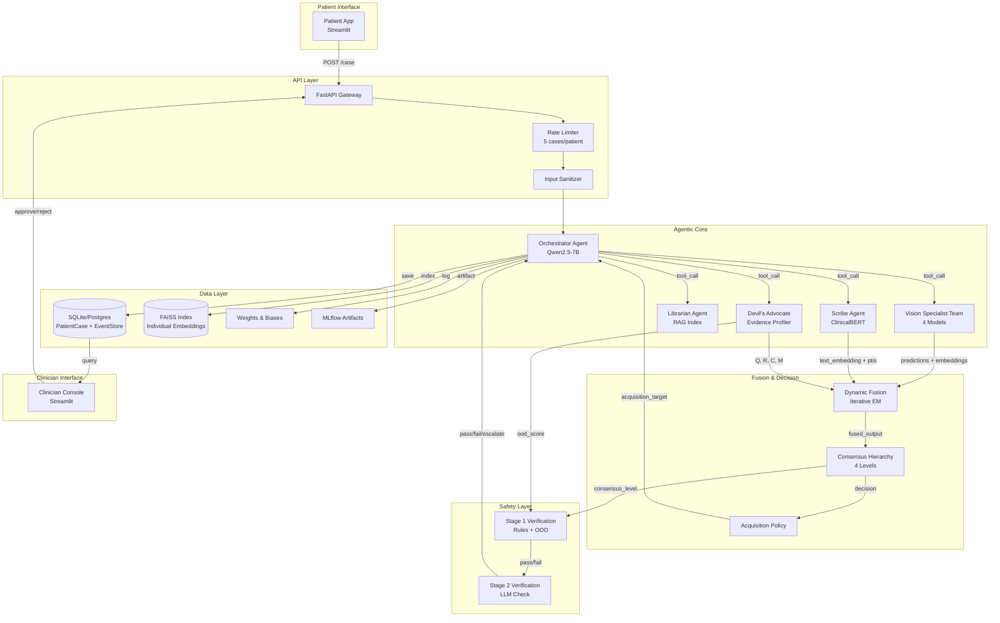

### 4.2 Component Communication Details

| From | To | Protocol | Data | Frequency |
|------|-----|----------|------|-----------|
| Patient App | FastAPI | HTTP/JSON | Case submission | Per request |
| FastAPI | Orchestrator | Python call | Structured case dict | Per request |
| Orchestrator | Vision Team | Tool call | Image tensors | Per request |
| Orchestrator | Scribe | Tool call | Raw text + metadata | Per request |
| Orchestrator | Librarian | Tool call | Query embedding | Per request |
| Orchestrator | Devil's Advocate | Tool call | All evidence + predictions | Per request |
| Vision Team | Dynamic Fusion | Python call | Embeddings + predictions | Per request |
| Scribe | Dynamic Fusion | Python call | Text embedding + quality | Per request |
| Devil's Advocate | Dynamic Fusion | Python call | Q, R, C, M scores | Per request |
| Dynamic Fusion | Consensus | Python call | Fused prediction + weights | Per iteration |
| Consensus | Acquisition | Python call | Consensus level + uncertainty | If Level 2/3 |
| Devil's Advocate | Verification Stage 1 | Python call | OOD score + conflict flag | Per request |
| Orchestrator | Verification Stage 2 | LLM prompt | Report draft + evidence JSON | Per request |
| All agents | Database | SQL/ORM | PatientCase + EventTrace | Per write |
| All agents | FAISS | Vector search | Individual embeddings | Per retrieval |
| Training | W&B | HTTP API | Metrics + logs | Per step |

### 4.3 Technology Stack

| Layer | Technology | Justification |
|-------|-----------|---------------|
| **Frontend** | Streamlit | Rapid prototyping, Python-native, sufficient for research demo |
| **Backend API** | FastAPI | Async support, automatic OpenAPI docs, Pydantic validation |
| **Agent Framework** | Custom tool-calling | Lightweight; LangChain/CrewAI overkill for 5 agents |
| **Vision Models** | PyTorch + timm + HuggingFace Transformers | Standard research stack |
| **Text Models** | HuggingFace Transformers (ClinicalBERT) | Domain-adapted, proven in medical NLP |
| **LLM** | Qwen2.5-7B-Instruct via Ollama | Local, deterministic, sufficient for structured tasks |
| **Database** | SQLite (demo) / Postgres (production) | SQLite eliminates DevOps for demo |
| **Vector DB** | FAISS | Mature, CPU-friendly, sufficient for <10k cases |
| **Config** | Hydra + OmegaConf | Composable configs, CLI overrides, reproducibility |
| **Logging** | Python structlog + W&B | Structured JSON + experiment tracking |
| **Model Registry** | MLflow | Version artifacts, reproducibility |
| **Testing** | pytest + coverage | Standard Python testing |
| **CI/CD** | GitHub Actions | Free for public repos, sufficient for research |
| **Container** | Docker | Reproducible environment |
| **Cloud** | Local GPU server | Research prototype; cloud only for demo hosting |

---

## 5. USER JOURNEYS

### 5.1 Journey 1: Patient Submits New Case

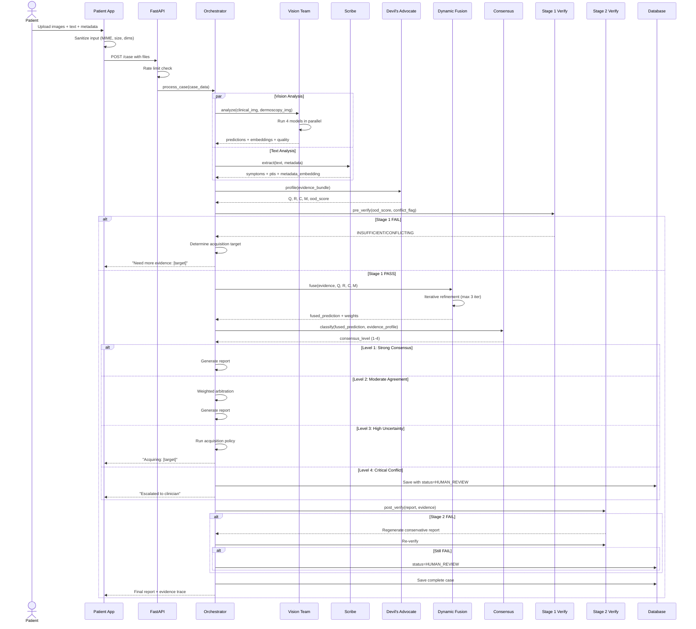

### 5.2 Journey 2: Clinician Reviews Escalated Case

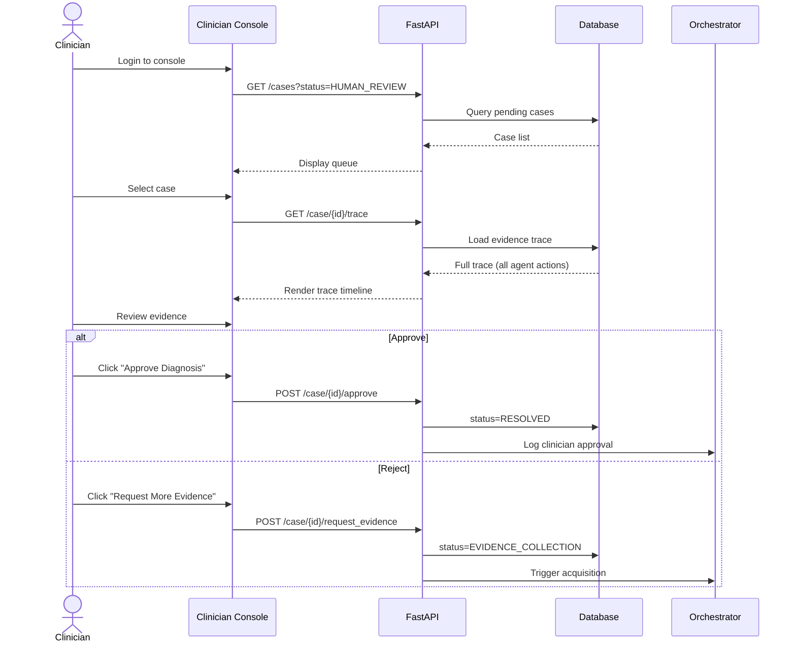

### 5.3 Journey 3: Researcher Runs DERMA-STRESS Benchmark

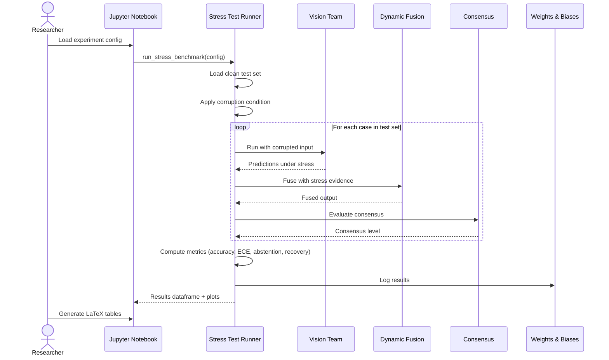

---

## 6. BACKEND ARCHITECTURE

### 6.1 Layer Responsibilities

| Layer | Responsibility | Example |
|-------|---------------|---------|
| **Controllers** | HTTP request handling, input validation, response formatting | `POST /case`, `GET /case/{id}` |
| **Services** | Orchestrate agent calls, manage business logic | `CaseProcessingService` |
| **Agents** | Independent specialist modules with single responsibility | `VisionSpecialistTeam`, `ScribeAgent` |
| **Repositories** | Database access, CRUD operations | `PatientCaseRepository` |
| **Models** | Pydantic schemas for request/response + SQLAlchemy entities | `PatientCase`, `EvidenceTraceEntry` |
| **Fusion** | Dynamic fusion algorithm, iterative refinement | `DiagnosisAdaptiveFusion` |
| **Evidence** | Q, R, U, C, M computation | `QualityEstimator`, `ReliabilityEstimator` |
| **LLM** | Prompt templates, structured output parsing | `LLMClient`, `PromptRegistry` |
| **Config** | Hydra configs, environment variables | `config.yaml`, `.env` |
| **Utils** | Shared utilities (hashing, image processing, logging) | `image_utils.py`, `hash_utils.py` |

### 6.2 Backend Folder Structure

```text
backend/
├── src/
│   ├── __init__.py
│   ├── main.py                    # FastAPI app entry point
│   ├── config/                    # Hydra configs
│   │   ├── config.yaml
│   │   ├── model/
│   │   ├── data/
│   │   └── experiment/
│   ├── api/                       # Controllers / routes
│   │   ├── __init__.py
│   │   ├── routes/
│   │   │   ├── cases.py
│   │   │   ├── clinicians.py
│   │   │   └── health.py
│   │   ├── dependencies.py        # auth, rate limiting
│   │   └── schemas.py             # Pydantic request/response models
│   ├── services/
│   │   ├── __init__.py
│   │   ├── case_processor.py      # Main orchestration service
│   │   └── stress_runner.py       # DERMA-STRESS execution
│   ├── agents/
│   │   ├── __init__.py
│   │   ├── orchestrator.py        # OrchestratorAgent
│   │   ├── vision_team.py         # VisionSpecialistTeam
│   │   ├── scribe.py              # ScribeAgent
│   │   ├── librarian.py           # LibrarianAgent
│   │   └── devils_advocate.py     # DevilsAdvocateAgent
│   ├── fusion/
│   │   ├── __init__.py
│   │   ├── adaptive_fusion.py     # DiagnosisAdaptiveFusion
│   │   ├── consensus.py           # 4-level hierarchy
│   │   └── acquisition.py         # Acquisition policy
│   ├── evidence/
│   │   ├── __init__.py
│   │   ├── quality.py             # Q computation
│   │   ├── reliability.py           # R computation
│   │   ├── utility.py             # U computation (retrospective)
│   │   ├── consistency.py         # C computation
│   │   └── missingness.py         # M tracking
│   ├── models/                    # Database models
│   │   ├── __init__.py
│   │   ├── patient_case.py
│   │   ├── evidence_trace.py
│   │   └── prediction.py
│   ├── repositories/
│   │   ├── __init__.py
│   │   ├── case_repository.py
│   │   └── trace_repository.py
│   ├── llm/
│   │   ├── __init__.py
│   │   ├── client.py              # Ollama/Qwen wrapper
│   │   ├── prompts.py             # All prompt templates
│   │   ├── extraction.py          # Symptom extraction
│   │   ├── report_gen.py          # Report generation
│   │   └── verification.py        # LLM verification
│   ├── retrieval/
│   │   ├── __init__.py
│   │   ├── faiss_index.py         # FAISS index management
│   │   └── rag_query.py           # Similar case retrieval
│   ├── explain/
│   │   ├── __init__.py
│   │   └── gradcam.py             # Grad-CAM for Swin/PanDerm
│   ├── stress/
│   │   ├── __init__.py
│   │   ├── corruptions.py         # All 15 corruption functions
│   │   └── benchmark.py           # Stress test runner
│   ├── eval/
│   │   ├── __init__.py
│   │   ├── metrics.py             # AUROC, ECE, Brier, etc.
│   │   ├── ablation.py            # Ablation study runner
│   │   └── stats.py               # Bootstrap CIs
│   ├── data/
│   │   ├── __init__.py
│   │   ├── loaders.py             # Derm7pt + PAD-UFES-20 loaders
│   │   ├── preprocessing.py       # Image transforms
│   │   ├── audit.py               # Hash checks, leakage detection
│   │   └── splits.py              # Split generation/loading
│   └── utils/
│       ├── __init__.py
│       ├── image_utils.py
│       ├── hash_utils.py
│       ├── logging_utils.py
│       └── security_utils.py
├── tests/
│   ├── __init__.py
│   ├── conftest.py
│   ├── test_data_pipeline.py
│   ├── test_vision_team.py
│   ├── test_evidence_profiler.py
│   ├── test_fusion.py
│   ├── test_consensus.py
│   ├── test_verification.py
│   ├── test_orchestrator.py
│   └── test_api.py
├── scripts/
│   ├── dataset_audit.py
│   ├── train_vision.py
│   ├── train_fusion.py
│   ├── run_stress.py
│   └── demo.py
├── notebooks/
│   ├── 01_data_exploration.ipynb
│   ├── 02_baseline_ladder.ipynb
│   ├── 03_ablation_analysis.ipynb
│   └── 04_derma_stress_results.ipynb
├── experiments/                   # W&B / MLflow outputs
├── docs/
│   ├── dataset_licenses/
│   ├── limitations.md
│   └── repro_statement.md
├── Dockerfile
├── docker-compose.yml
├── requirements.txt
├── requirements-dev.txt
├── pyproject.toml
└── README.md
```

---

## 7. FRONTEND ARCHITECTURE

### 7.1 Architecture Overview

The frontend consists of two Streamlit applications:

1. **Patient App** — Case submission + status tracking
2. **Clinician Console** — Case review queue + evidence trace viewer + approval controls

### 7.2 Pages & Components

**Patient App:**
- `pages/01_submit_case.py` — Upload form (drag-and-drop images, text area, metadata form)
- `pages/02_case_status.py` — Track case status with evidence timeline
- `pages/03_results.py` — View final report (if not escalated)

**Clinician Console:**
- `pages/01_queue.py` — Pending cases table with filters
- `pages/02_case_review.py` — Full evidence trace viewer (expandable timeline)
- `pages/03_approve_reject.py` — Decision buttons + comment field

### 7.3 State Management

Streamlit's session state is sufficient:
```python
# session_state keys
- case_id: str
- uploaded_files: dict
- current_status: str
- evidence_trace: list
- final_report: dict
```

### 7.4 API Communication

```python
# frontend/api_client.py
import requests

BASE_URL = "http://localhost:8000"

def submit_case(files, text, metadata):
    response = requests.post(
        f"{BASE_URL}/cases",
        files=files,
        data={"text": text, "metadata": json.dumps(metadata)}
    )
    return response.json()

def get_case_status(case_id):
    return requests.get(f"{BASE_URL}/cases/{case_id}").json()

def get_evidence_trace(case_id):
    return requests.get(f"{BASE_URL}/cases/{case_id}/trace").json()

def clinician_approve(case_id, comment):
    return requests.post(
        f"{BASE_URL}/cases/{case_id}/approve",
        json={"comment": comment}
    ).json()
```

### 7.5 Frontend Folder Structure

```text
frontend/
├── app.py                         # Entry point (navigation)
├── pages/
│   ├── 01_submit_case.py
│   ├── 02_case_status.py
│   ├── 03_results.py
│   ├── 01_queue.py
│   ├── 02_case_review.py
│   └── 03_approve_reject.py
├── components/
│   ├── image_uploader.py
│   ├── evidence_timeline.py
│   ├── consensus_badge.py
│   └── report_card.py
├── api_client.py
├── config.py
└── requirements.txt
```

---

## 8. DATABASE ARCHITECTURE

### 8.1 Entity Relationship Diagram

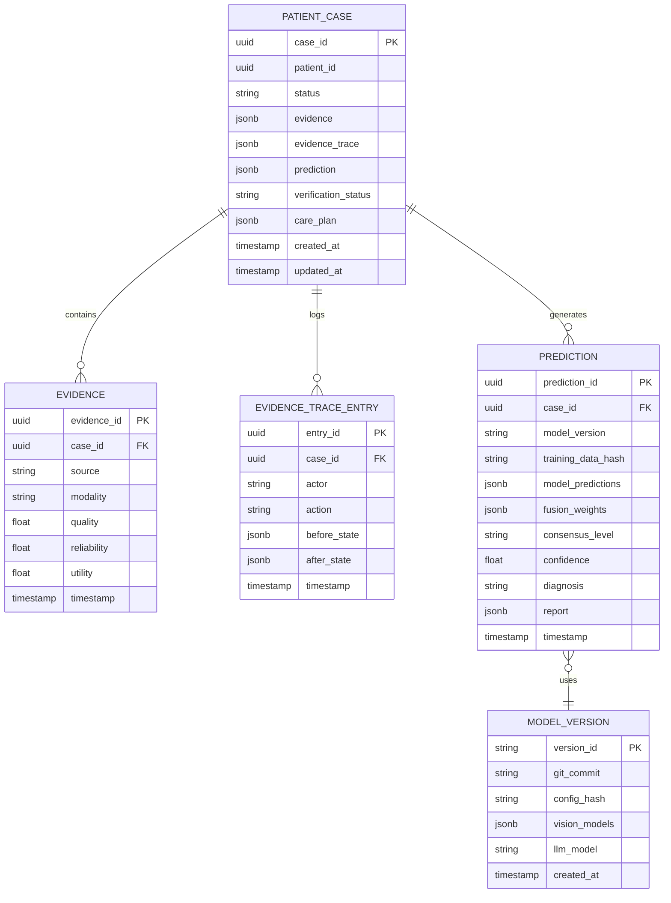

### 8.2 Table Descriptions

#### `patient_case`
The central entity representing a single diagnostic case. `evidence` is JSONB containing the four modality inputs. `evidence_trace` is an append-only log of all system actions. `status` follows the state machine: `NEW → INTAKE → TRIAGE → EVIDENCE_COLLECTION → ASSESSMENT → VERIFICATION → {HUMAN_REVIEW | CARE_PLANNING → MONITORING → RESOLVED}`.

#### `evidence`
Individual evidence items linked to a case. Stores per-modality quality/reliability/utility scores computed by the Devil's Advocate.

#### `evidence_trace_entry`
Immutable audit log. Every agent action, state transition, and decision is recorded here. This is the backbone of observability and regulatory compliance.

#### `prediction`
Stores the final (or intermediate) prediction output. `model_version` links to the exact model configuration used. `fusion_weights` records the diagnosis-adaptive weights for reproducibility.

#### `model_version`
Registry of all deployed model configurations. Enables rollback and reproducibility.

### 8.3 Indexes

```sql
-- Fast case lookup by patient
CREATE INDEX idx_case_patient ON patient_case(patient_id);

-- Fast status filtering for clinician queue
CREATE INDEX idx_case_status ON patient_case(status);

-- Fast trace retrieval
CREATE INDEX idx_trace_case ON evidence_trace_entry(case_id);

-- Fast prediction lookup
CREATE INDEX idx_prediction_case ON prediction(case_id);
```

### 8.4 Data Retention

- Research prototype: retain all data indefinitely
- Production (future): archive cases older than 7 years (HIPAA compliance)
- Event store: compact after 90 days (move to cold storage)

---

## 9. API DESIGN

### 9.1 Case Submission

```text
POST /api/v1/cases

Purpose:
Submit a new diagnostic case with all available evidence.

Authentication:
Not required (research prototype).

Rate Limiting:
5 pending cases per patient_id (429 Too Many Requests if exceeded).

Request:
Content-Type: multipart/form-data

{
  "patient_id": "uuid",
  "clinical_image": <file>,
  "dermoscopy_image": <file>,
  "patient_text": "The spot on my arm has been growing for 3 weeks...",
  "metadata": {
    "age": 45,
    "sex": "M",
    "location": "arm",
    "history": "sun_exposure"
  }
}

Validation:
- clinical_image: JPEG/PNG, <10MB, 32x32 to 4096x4096
- dermoscopy_image: JPEG/PNG, <10MB, 32x32 to 4096x4096
- patient_text: max 2000 characters
- metadata: JSON object with known schema

Response (202 Accepted):
{
  "case_id": "uuid",
  "status": "INTAKE",
  "message": "Case accepted for processing",
  "estimated_time": "30 seconds"
}

Error Responses:
400 Bad Request - Invalid input (details in response)
429 Too Many Requests - Rate limit exceeded
413 Payload Too Large - File >10MB
500 Internal Server Error - Processing failure
```

### 9.2 Get Case Status

```text
GET /api/v1/cases/{case_id}

Purpose:
Retrieve current case status and results if available.

Authentication:
Not required.

Response (200 OK):
{
  "case_id": "uuid",
  "patient_id": "uuid",
  "status": "ASSESSMENT",
  "evidence": {
    "clinical_image": {"quality": 0.85, "reliability": 0.92},
    "dermoscopy_image": {"quality": 0.78, "reliability": 0.88},
    "patient_text": {"ptis": 0.65, "quality": 0.70},
    "metadata": {"quality": 0.90, "missing_fraction": 0.1}
  },
  "prediction": {
    "diagnosis": "melanoma",
    "confidence": 0.87,
    "consensus_level": 1,
    "fusion_weights": {
      "dermlip_panderm": 0.35,
      "panderm": 0.25,
      "swin_tiny": 0.25,
      "resnet152": 0.15
    }
  },
  "report": {
    "summary": "The lesion shows concerning features...",
    "evidence_used": ["dermoscopy_image", "patient_text", "metadata"],
    "evidence_missing": ["clinical_image"],
    "conflicts": [],
    "acquisition_recommendation": null
  },
  "created_at": "2026-08-25T22:17:00+05:30",
  "updated_at": "2026-08-25T22:17:28+05:30"
}

Response (202 Accepted) - Still processing:
{
  "case_id": "uuid",
  "status": "TRIAGE",
  "message": "Case is being processed"
}
```

### 9.3 Clinician Review

```text
POST /api/v1/cases/{case_id}/clinician-action

Purpose:
Approve, reject, or request more evidence for a case in HUMAN_REVIEW status.

Authentication:
Required (API key or session token).

Authorization:
Role = clinician.

Request:
{
  "action": "approve" | "reject" | "request_evidence",
  "comment": "Additional dermoscopy needed for confirmation",
  "evidence_request": "dermoscopy_image"  // required if action=request_evidence
}

Validation:
- case must be in HUMAN_REVIEW status
- action must be one of allowed values
- comment required for reject/request_evidence

Response (200 OK):
{
  "case_id": "uuid",
  "new_status": "CARE_PLANNING",
  "action": "approve",
  "comment": "Approved with confidence",
  "timestamp": "2026-08-25T22:20:00+05:30"
}

Error Responses:
403 Forbidden - Not a clinician
409 Conflict - Case not in HUMAN_REVIEW status
```

### 9.4 Run DERMA-STRESS Benchmark

```text
POST /api/v1/benchmarks/stress

Purpose:
Run DERMA-STRESS benchmark on test set.

Authentication:
API key (researcher access).

Request:
{
  "dataset": "derm7pt" | "pad_ufes",
  "split": "test",
  "conditions": ["all"] | ["blur", "noise", "missing_clinical"],
  "model_variant": "full" | "consensus_only" | "evidence_only"
}

Response (202 Accepted):
{
  "benchmark_id": "uuid",
  "status": "running",
  "estimated_time": "45 minutes"
}

GET /api/v1/benchmarks/{benchmark_id}

Response (200 OK):
{
  "benchmark_id": "uuid",
  "status": "completed",
  "results": {
    "clean": {"accuracy": 0.855, "ece": 0.08},
    "blur": {"accuracy": 0.792, "ece": 0.12},
    "noise": {"accuracy": 0.781, "ece": 0.14}
  },
  "abstention_rates": {
    "clean": 0.05,
    "blur": 0.18,
    "noise": 0.22
  }
}
```

---

## 10. DATA FLOW

### 10.1 Synchronous Flow (Normal Case Processing)

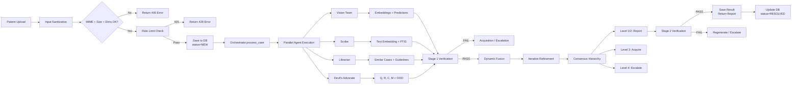

### 10.2 Asynchronous Flow (DERMA-STRESS Batch)

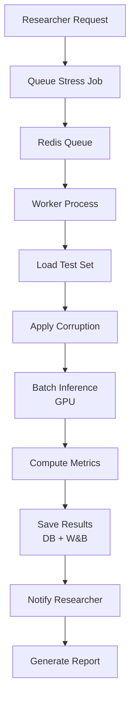

### 10.3 Evidence Trace Flow

Every action appends to `evidence_trace`:

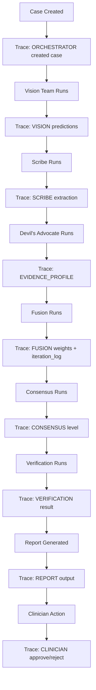

---

## 11. CODE ARCHITECTURE

### 11.1 Repository Structure

```text
DERMA-GUARD/
├── .github/
│   └── workflows/
│       ├── ci.yml                 # Lint + Test + Coverage
│       └── release.yml            # Docker build + push
├── configs/                       # Hydra configs
│   ├── base.yaml
│   ├── model/
│   │   ├── vision/
│   │   │   ├── dermlip_panderm.yaml
│   │   │   ├── panderm.yaml
│   │   │   ├── swin_tiny.yaml
│   │   │   └── resnet152.yaml
│   │   ├── text/
│   │   │   └── clinicalbert.yaml
│   │   └── fusion/
│   │       └── adaptive.yaml
│   ├── data/
│   │   ├── derm7pt.yaml
│   │   └── pad_ufes.yaml
│   └── experiment/
│       ├── baseline_ladder/
│       ├── ablation/
│       └── stress/
├── data/
│   ├── raw/                       # Original datasets (gitignored)
│   ├── interim/                   # Preprocessed but not split
│   ├── processed/                 # Ready for training
│   └── splits/                    # Frozen split files (committed)
│       ├── derm7pt_train.json
│       ├── derm7pt_val.json
│       ├── derm7pt_test.json
│       ├── padufes_train.json
│       ├── padufes_val.json
│       └── padufes_test.json
├── src/                           # All source code
│   ├── __init__.py
│   ├── main.py                    # FastAPI entry
│   ├── config/                    # Config loading utilities
│   ├── api/
│   ├── services/
│   ├── agents/
│   ├── fusion/
│   ├── evidence/
│   ├── models/                    # DB models
│   ├── repositories/
│   ├── llm/
│   ├── retrieval/
│   ├── explain/
│   ├── stress/
│   ├── eval/
│   ├── data/
│   └── utils/
├── tests/                         # All tests
├── scripts/                       # Executable scripts
├── notebooks/                     # Analysis notebooks
├── experiments/                   # W&B outputs (gitignored)
├── app/                           # Streamlit apps
│   ├── patient_app.py
│   └── clinician_console.py
├── docs/
│   ├── architecture.md
│   ├── api_reference.md
│   ├── limitations.md
│   └── repro_statement.md
├── docker/
│   ├── Dockerfile
│   └── docker-compose.yml
├── requirements.txt
├── requirements-dev.txt
├── pyproject.toml
├── setup.py
├── .gitignore
├── .dockerignore
├── .env.example
└── README.md
```

### 11.2 Dependency Rules

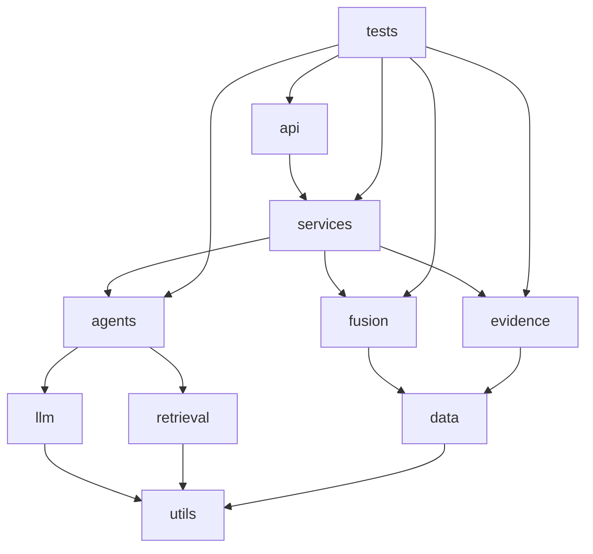

**Rules:**
- `api` depends only on `services`
- `services` orchestrates `agents`, `fusion`, `evidence`
- `agents` are independent of each other
- `fusion` depends on `data` for transforms
- No circular dependencies allowed
- `tests` can import any layer

### 11.3 Naming Conventions

| Category | Convention | Example |
|----------|-----------|---------|
| Classes | PascalCase | `VisionSpecialistTeam` |
| Functions | snake_case | `compute_quality_score` |
| Constants | UPPER_SNAKE_CASE | `MAX_IMAGE_SIZE_MB` |
| Private | leading underscore | `_validate_input` |
| Files | snake_case | `adaptive_fusion.py` |
| Configs | snake_case.yaml | `swin_tiny.yaml` |

### 11.4 Configuration Management

Using Hydra + OmegaConf:

```yaml
# configs/base.yaml
defaults:
  - model/vision/dermlip_panderm
  - model/vision/panderm
  - model/vision/swin_tiny
  - model/vision/resnet152
  - model/text/clinicalbert
  - model/fusion/adaptive
  - data/derm7pt

project:
  name: derma-guard
  seed: 42

training:
  batch_size: 32
  epochs: 100
  lr: 1e-4
  weight_decay: 0.05
  gradient_clip: 1.0
  mixed_precision: true
  early_stopping:
    patience: 10
    monitor: val_macro_f1
    mode: max

fusion:
  max_iterations: 3
  convergence_threshold: 0.05
  diagnosis_adaptive: true

consensus:
  strong_threshold: 0.80
  conflict_threshold: 0.60
  entropy_threshold: 1.5
  quality_threshold: 0.30

llm:
  model: qwen2.5:7b
  max_tokens: 512
  timeout: 30
  temperature: 0.0
  max_retries: 2
```

Override via CLI:
```bash
python train.py model/fusion=adaptive data=pad_ufes training.batch_size=16
```

### 11.5 Error Handling

```python
# src/utils/exceptions.py
class DermaGuardError(Exception):
    """Base exception."""
    pass

class InputValidationError(DermaGuardError):
    """Invalid input (MIME type, size, dimensions)."""
    pass

class ModelLoadError(DermaGuardError):
    """Failed to load model weights."""
    pass

class LLMTimeoutError(DermaGuardError):
    """LLM call exceeded timeout."""
    pass

class OODDetectedError(DermaGuardError):
    """Case flagged as out-of-distribution."""
    pass

class ConsensusConflictError(DermaGuardError):
    """Critical conflict detected."""
    pass
```

### 11.6 Logging

```python
# src/utils/logging_utils.py
import structlog
import logging

def setup_logging():
    structlog.configure(
        processors=[
            structlog.stdlib.filter_by_level,
            structlog.stdlib.add_logger_name,
            structlog.stdlib.add_log_level,
            structlog.stdlib.PositionalArgumentsFormatter(),
            structlog.processors.TimeStamper(fmt="iso"),
            structlog.processors.StackInfoRenderer(),
            structlog.processors.format_exc_info,
            structlog.processors.UnicodeDecoder(),
            structlog.processors.JSONRenderer()
        ],
        context_class=dict,
        logger_factory=structlog.stdlib.LoggerFactory(),
        wrapper_class=structlog.stdlib.BoundLogger,
        cache_logger_on_first_use=True,
    )
```

---

## 12. DEVELOPMENT WORKFLOW

### 12.1 Step-by-Step

```bash
# 1. Clone repository
git clone https://github.com/your-org/derma-guard.git
cd derma-guard

# 2. Create virtual environment
python -m venv venv
source venv/bin/activate  # Windows: venv\Scripts\activate

# 3. Install dependencies
pip install -r requirements.txt
pip install -r requirements-dev.txt

# 4. Configure environment
cp .env.example .env
# Edit .env with your paths and API keys

# 5. Download datasets
python scripts/download_datasets.py
# Or manually place in data/raw/

# 6. Run dataset audit
python scripts/dataset_audit.py
# Block until clean

# 7. Create frozen splits
python scripts/make_splits.py

# 8. Verify setup
pytest tests/test_data_pipeline.py -v

# 9. Start Ollama (for LLM)
ollama pull qwen2.5:7b

# 10. Run FastAPI backend
uvicorn src.main:app --reload --port 8000

# 11. Run Streamlit frontend (new terminal)
streamlit run app/patient_app.py --server.port 8501

# 12. Verify end-to-end
# Upload a test case via Patient App
# Check Clinician Console at http://localhost:8502
```

### 12.2 Feature Development Workflow

```bash
# 1. Create feature branch
git checkout -b feature/evidence-profiler-ood

# 2. Implement feature
# Edit src/evidence/quality.py, src/evidence/reliability.py

# 3. Write tests
# Edit tests/test_evidence_profiler.py

# 4. Run tests
pytest tests/test_evidence_profiler.py -v --cov=src.evidence

# 5. Run linting
black src/ tests/
isort src/ tests/
flake8 src/ tests/
mypy src/

# 6. Commit
git add .
git commit -m "feat(evidence): add Mahalanobis OOD detector
- Implement OOD scoring using class-conditional Mahalanobis distance
- Calibrate threshold on validation set
- Add tests for OOD detection accuracy"

# 7. Push and create PR
git push origin feature/evidence-profiler-ood
# Create PR on GitHub with description

# 8. CI runs automatically
# - Lint check
# - Unit tests
# - Coverage check (must be ≥70%)

# 9. Code review
# At least 1 approval required

# 10. Merge to main
# Squash and merge
```

### 12.3 Definition of Done (Per Feature)

- [ ] Feature implemented and tested
- [ ] Unit tests pass (≥70% coverage for new code)
- [ ] Integration tests pass
- [ ] Code reviewed and approved
- [ ] Documentation updated (docstrings + README if needed)
- [ ] Hydra config updated if new parameters added
- [ ] W&B logging added if new metrics
- [ ] No linting errors
- [ ] CI pipeline green

---

**End of Part 1 (Sections 1–12).**

Ready for **Part 2 (Sections 13–25)**?
 Here is **Part 2** — Sections 13 through 25.

---

# PART 2 — SECTIONS 13 THROUGH 25

---

## 13. GIT / BRANCHING STRATEGY

### 13.1 Branch Model

We use **GitHub Flow** (lightweight trunk-based development) adapted for a small research team:

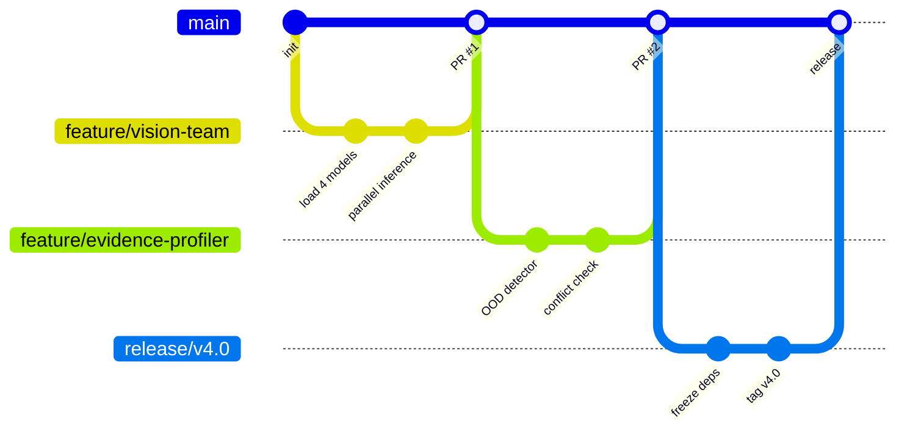

### 13.2 Branch Naming

| Type | Pattern | Example |
|------|---------|---------|
| Feature | `feature/<module>-<description>` | `feature/fusion-iterative-refinement` |
| Bugfix | `fix/<module>-<description>` | `fix/vision-missing-modality-mask` |
| Experiment | `exp/<hypothesis>` | `exp/focal-loss-gamma-2` |
| Documentation | `docs/<description>` | `docs/api-reference` |
| Hotfix | `hotfix/<description>` | `hotfix/ood-division-by-zero` |

### 13.3 Commit Conventions

We use **Conventional Commits** for automatic changelog generation:

```
<type>(<scope>): <description>

[optional body]

[optional footer]
```

| Type | Use When | Example |
|------|----------|---------|
| `feat` | New feature | `feat(evidence): add Mahalanobis OOD detector` |
| `fix` | Bug fix | `fix(fusion): prevent division by zero on empty cases` |
| `refactor` | Code restructuring | `refactor(vision): extract base model class` |
| `test` | Adding tests | `test(consensus): add Level 3 boundary cases` |
| `docs` | Documentation | `docs(readme): add DERMA-STRESS instructions` |
| `chore` | Maintenance | `chore(deps): bump torch to 2.3.0` |
| `perf` | Performance | `perf(inference): batch vision model calls` |

### 13.4 Pull Request Rules

1. **Title:** Must follow conventional commit format
2. **Description:** Must include:
   - What changed
   - Why it changed
   - How to test it
   - Link to related issue (if any)
3. **Review:** Minimum 1 approval from team member who did not write the code
4. **CI:** All checks must pass (lint, test, coverage ≥70%)
5. **Size:** PRs should be <400 lines of code when possible

### 13.5 Merge Strategy

- **Default:** Squash and merge (keeps `main` history clean)
- **Release:** Merge commit (preserves feature branch history)
- **Hotfix:** Fast-forward merge if possible

### 13.6 Versioning

We use **Semantic Versioning** for releases:

```
v4.0.0    # Major: new architecture (multi-agent)
v4.1.0    # Minor: new feature (e.g., gradient-boosted acquisition)
v4.1.1    # Patch: bug fix (e.g., OOD threshold calibration)
```

Tags are created on `release/*` branches only.

### 13.7 Why This Strategy

- **GitHub Flow** is simpler than GitFlow for a small team (3–4 developers)
- **Conventional Commits** enable `git log` readability and automated changelogs
- **Squash merge** keeps `main` bisectable and clean
- **Small PRs** force atomic changes, making rollback easier

---

## 14. TESTING STRATEGY

### 14.1 Testing Pyramid

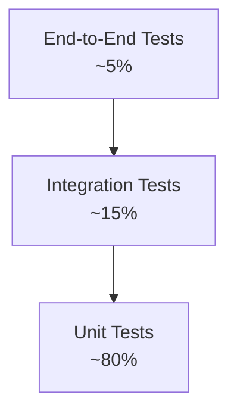

### 14.2 Unit Testing

**What to test:** Every public function in `src/`  
**How:** `pytest` with `pytest-cov`  
**When:** On every commit (pre-commit hook) and every PR (CI)  
**Owner:** Developer who wrote the code

| Module | Test File | Key Test Cases |
|--------|-----------|----------------|
| `data.loaders` | `test_data_pipeline.py` | Split reproducibility, class distribution, image normalization |
| `data.audit` | `test_data_pipeline.py` | Hash collision detection, missingness flags |
| `agents.vision_team` | `test_vision_team.py` | All 4 models load, predict correct shape, handle missing image |
| `agents.scribe` | `test_scribe.py` | Symptom extraction accuracy, PTIS range [0,1], unknown handling |
| `agents.devils_advocate` | `test_evidence_profiler.py` | OOD score > threshold for adversarial input, JS divergence symmetry |
| `fusion.adaptive_fusion` | `test_fusion.py` | Convergence in ≤3 iterations, weight sum = 1.0, missing modality mask |
| `fusion.consensus` | `test_consensus.py` | Level 1–4 boundary cases, empty evidence handling |
| `llm.extraction` | `test_llm.py` | JSON schema compliance, timeout fallback, retry logic |
| `verification.rules` | `test_verification.py` | Known pass/fail cases, unsupported claim detection |

**Example Unit Test:**

```python
# tests/test_fusion.py
import pytest
import torch
from src.fusion.adaptive_fusion import DiagnosisAdaptiveFusion

def test_fusion_converges_within_three_iterations():
    fusion = DiagnosisAdaptiveFusion(num_modalities=4, num_classes=6)
    evidence = {
        'embeddings': [torch.randn(768) for _ in range(4)],
        'quality': torch.tensor([0.8, 0.7, 0.9, 0.6]),
        'reliability': torch.tensor([0.9, 0.8, 0.85, 0.7]),
        'consistency': 0.75,
        'missing_mask': torch.tensor([1, 1, 1, 0])  # modality 4 missing
    }
    
    output = fusion.fuse(evidence, num_iterations=3)
    
    assert output['converged'] is True
    assert output['iterations_used'] <= 3
    assert abs(output['weights'].sum().item() - 1.0) < 1e-6
    assert output['weights'][3].item() == 0.0  # missing modality has zero weight

def test_fusion_raises_on_all_missing():
    fusion = DiagnosisAdaptiveFusion(num_modalities=4, num_classes=6)
    evidence = {
        'embeddings': [torch.randn(768) for _ in range(4)],
        'quality': torch.zeros(4),
        'reliability': torch.zeros(4),
        'missing_mask': torch.zeros(4)
    }
    with pytest.raises(ValueError, match="INSUFFICIENT_EVIDENCE"):
        fusion.fuse(evidence)
```

### 14.3 Integration Testing

**What to test:** Agent interactions, end-to-end data flow, database writes  
**How:** `pytest` with temporary SQLite database, mocked LLM calls  
**When:** On every PR  
**Owner:** Tech lead

| Flow | Test File | Scenario |
|------|-----------|----------|
| Full pipeline | `test_orchestrator.py` | Clean case → Level 1 consensus |
| Missing modality | `test_orchestrator.py` | Missing dermoscopy → Level 3 → acquisition |
| OOD case | `test_orchestrator.py` | Adversarial image → Stage 1 block → escalation |
| Corrupted input | `test_api.py` | Invalid MIME type → 400 error |

### 14.4 API Testing

**Tool:** `pytest` + `httpx` (async client) + `TestClient` from FastAPI

```python
# tests/test_api.py
from fastapi.testclient import TestClient
from src.main import app

client = TestClient(app)

def test_submit_case_valid():
    response = client.post(
        "/api/v1/cases",
        data={"patient_id": "test-123", "patient_text": "Growing mole"},
        files={"clinical_image": ("test.jpg", b"fake_image_bytes", "image/jpeg")}
    )
    assert response.status_code == 202
    assert "case_id" in response.json()

def test_submit_case_invalid_mime():
    response = client.post(
        "/api/v1/cases",
        files={"clinical_image": ("test.exe", b"fake_exe", "application/x-msdownload")}
    )
    assert response.status_code == 400
```

### 14.5 Database Testing

**Tool:** `pytest` + `sqlite3` in-memory database

- Test CRUD operations for `PatientCase`, `EvidenceTraceEntry`, `Prediction`
- Test foreign key constraints
- Test index performance (explain query plans)

### 14.6 End-to-End Testing

**Tool:** `pytest` + `playwright` (for Streamlit frontend)

| Scenario | Steps |
|----------|-------|
| Patient submits case | Open app → upload image → enter text → submit → verify status page |
| Clinician reviews case | Open console → click case → view trace → approve → verify status change |

### 14.7 Performance Testing

**Tool:** `locust` or `pytest-benchmark`

| Metric | Target | Test |
|--------|--------|------|
| Single-case inference | ≤30s | `pytest --benchmark-only` |
| Batch stress inference | ≤5s/case | Run 100 cases, measure p95 |
| Database query | ≤100ms | Query 1000 cases, measure latency |
| LLM call | ≤30s | Mock timeout scenario |

### 14.8 Security Testing

| Test | Tool | Scenario |
|------|------|----------|
| Input validation | `pytest` | Upload executable, oversized image, null bytes |
| SQL injection | `pytest` | Metadata field with `' OR 1=1 --` |
| Rate limiting | `locust` | 100 rapid requests from same patient_id |
| Dependency scan | `safety` / `pip-audit` | Weekly automated scan |

### 14.9 Regression Testing

- **Baseline ladder:** Re-run after every major change
- **DERMA-STRESS subset:** Run 3 conditions (clean, blur, missing) on every PR
- **Full DERMA-STRESS:** Run weekly on `main`

### 14.10 Testing Schedule

| Trigger | Tests Run | Time Budget |
|---------|-----------|-------------|
| Pre-commit | Lint + changed unit tests | <2 min |
| Pull Request | Full unit + integration + API | <10 min |
| Merge to main | Unit + integration + API + stress subset | <30 min |
| Nightly | Full DERMA-STRESS + coverage report | <2 hours |
| Release | All tests + manual QA checklist | <1 day |

---

## 15. SECURITY ARCHITECTURE

### 15.1 Threat Model

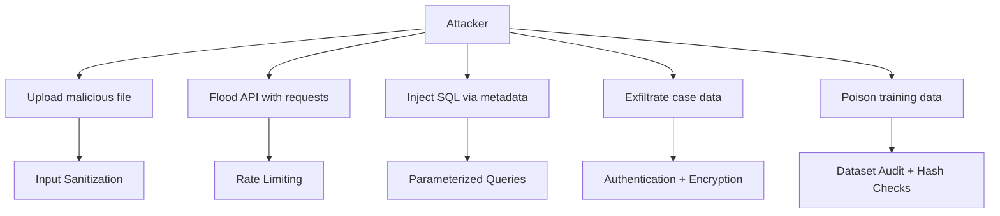

### 15.2 Security Measures

#### Authentication & Authorization

| Layer | Implementation |
|-------|---------------|
| Patient App | None (research prototype; future: OAuth2) |
| Clinician Console | API key + role check (`role=clinician`) |
| API endpoints | Bearer token for clinician-only routes |
| Future | JWT with RBAC (admin, clinician, researcher, patient) |

#### Input Validation

```python
# src/utils/security_utils.py
import magic
from PIL import Image

MAX_FILE_SIZE = 10 * 1024 * 1024  # 10MB
ALLOWED_MIME = {'image/jpeg', 'image/png'}
MIN_DIM = 32
MAX_DIM = 4096

def sanitize_image(file_bytes: bytes) -> Image.Image:
    # MIME type check
    mime = magic.from_buffer(file_bytes, mime=True)
    if mime not in ALLOWED_MIME:
        raise InputValidationError(f"Invalid MIME type: {mime}")
    
    # Size check
    if len(file_bytes) > MAX_FILE_SIZE:
        raise InputValidationError(f"File too large: {len(file_bytes)} bytes")
    
    # Dimension check
    img = Image.open(io.BytesIO(file_bytes))
    if not (MIN_DIM <= img.width <= MAX_DIM and MIN_DIM <= img.height <= MAX_DIM):
        raise InputValidationError(f"Invalid dimensions: {img.width}x{img.height}")
    
    # Embedded executable check (basic)
    forbidden = [b'<?php', b'<script', b'%PDF', b'MZ']
    for sig in forbidden:
        if sig in file_bytes[:1024]:
            raise InputValidationError("Potential embedded executable detected")
    
    return img
```

#### SQL Injection Prevention

- Use SQLAlchemy ORM with parameterized queries
- Never use f-strings or string concatenation for SQL
- Validate all query parameters against Pydantic schemas

#### XSS Prevention

- Streamlit handles HTML escaping automatically
- If rendering markdown from LLM output, sanitize with `bleach`
- Set `Content-Security-Policy` headers in FastAPI

#### CSRF Prevention

- Not applicable for stateless API (uses tokens)
- For session-based future: implement CSRF tokens

#### Rate Limiting

```python
# src/api/dependencies.py
from fastapi import HTTPException, Request
import time

RATE_LIMITS = {}  # In production: use Redis

async def rate_limiter(request: Request, patient_id: str):
    key = f"rate:{patient_id}"
    now = time.time()
    
    # Cleanup old entries
    RATE_LIMITS[key] = [t for t in RATE_LIMITS.get(key, []) if now - t < 3600]
    
    if len(RATE_LIMITS.get(key, [])) >= 5:
        raise HTTPException(status_code=429, detail="Too many pending cases")
    
    RATE_LIMITS.setdefault(key, []).append(now)
```

#### Secrets Management

| Secret | Storage | Access |
|--------|---------|--------|
| HuggingFace token | `.env` file (gitignored) | Load at startup |
| W&B API key | `.env` file | Load at startup |
| Database URL | `.env` file | Load at startup |
| Clinician API keys | Database (hashed with bcrypt) | Verify on each request |

#### Encryption

- **At rest:** SQLite file permissions `600`; Postgres SSL
- **In transit:** HTTPS/TLS for all API communication
- **Future:** Encrypt PII fields in database (AES-256)

#### API Security

```python
# src/main.py
from fastapi.middleware.cors import CORSMiddleware
from fastapi.middleware.trustedhost import TrustedHostMiddleware

app.add_middleware(
    TrustedHostMiddleware,
    allowed_hosts=["localhost", "derma-guard.research.local"]
)

app.add_middleware(
    CORSMiddleware,
    allow_origins=["http://localhost:8501", "http://localhost:8502"],
    allow_methods=["GET", "POST"],
    allow_headers=["Authorization", "Content-Type"]
)
```

#### Dependency Vulnerabilities

```bash
# Weekly scan
pip-audit --desc
safety check
```

#### Logging & Auditing

- All authentication attempts logged
- All clinician actions logged with timestamp and IP
- Evidence trace is immutable append-only
- Log retention: 90 days active, archive to cold storage

### 15.3 Security Risk Table

| Risk | Probability | Impact | Mitigation |
|------|-------------|--------|------------|
| Malicious file upload (malware in image) | Medium | High | MIME check, size limit, dimension check, executable signature scan |
| API flooding (DoS) | Medium | Medium | Rate limiting (5 cases/patient), request timeout |
| SQL injection via metadata | Low | High | ORM parameterized queries, Pydantic validation |
| LLM prompt injection | Medium | High | Structured tool-calling only, max tokens, temperature=0, no free-text reasoning for diagnosis |
| Data exfiltration | Low | High | No PII in logs, local-only processing, API key auth for clinician routes |
| Model weight tampering | Low | High | Version pinning, SHA-256 checksums on model files, MLflow artifact signing |
| Dependency supply chain | Medium | Medium | `pip-audit`, `safety`, locked `requirements.txt` |

---

## 16. CI/CD PIPELINE

### 16.1 Pipeline Diagram

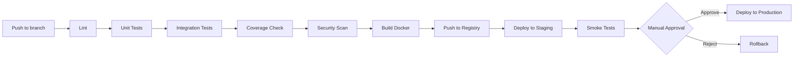

### 16.2 GitHub Actions Workflow

```yaml
# .github/workflows/ci.yml
name: CI

on:
  push:
    branches: [main, feature/*, fix/*]
  pull_request:
    branches: [main]

jobs:
  lint:
    runs-on: ubuntu-latest
    steps:
      - uses: actions/checkout@v4
      - uses: actions/setup-python@v5
        with:
          python-version: '3.10'
      - run: pip install black isort flake8 mypy
      - run: black --check src/ tests/
      - run: isort --check-only src/ tests/
      - run: flake8 src/ tests/
      - run: mypy src/

  test:
    runs-on: ubuntu-latest
    steps:
      - uses: actions/checkout@v4
      - uses: actions/setup-python@v5
        with:
          python-version: '3.10'
      - run: pip install -r requirements.txt -r requirements-dev.txt
      - run: pytest tests/ -v --cov=src --cov-report=xml --cov-fail-under=70
      - uses: codecov/codecov-action@v4
        with:
          files: ./coverage.xml

  security:
    runs-on: ubuntu-latest
    steps:
      - uses: actions/checkout@v4
      - uses: actions/setup-python@v5
        with:
          python-version: '3.10'
      - run: pip install pip-audit safety
      - run: pip-audit --desc
      - run: safety check

  build:
    needs: [lint, test, security]
    runs-on: ubuntu-latest
    steps:
      - uses: actions/checkout@v4
      - uses: docker/setup-buildx-action@v3
      - uses: docker/build-push-action@v5
        with:
          context: .
          push: false
          tags: derma-guard:${{ github.sha }}
```

### 16.3 Stage Descriptions

| Stage | Purpose | Failure Action |
|-------|---------|--------------|
| **Lint** | Code style consistency | Block PR merge |
| **Unit Tests** | Fast feedback on logic | Block PR merge |
| **Integration Tests** | Agent interaction correctness | Block PR merge |
| **Coverage Check** | Ensure ≥70% coverage | Block PR merge |
| **Security Scan** | Dependency vulnerabilities | Block PR merge if critical |
| **Build Docker** | Reproducible environment | Alert team |
| **Smoke Tests** | Basic health checks on staging | Block production deploy |
| **Manual Approval** | Human gate for production | Require 1 senior engineer |

---

## 17. DEPLOYMENT ARCHITECTURE

### 17.1 Environment Strategy

| Environment | Purpose | Data | GPU | Access |
|-------------|---------|------|-----|--------|
| **Development** | Local coding | Sample of 50 cases | Local GPU | Team only |
| **Testing** | Automated tests | Synthetic data | CPU (CI runner) | CI only |
| **Staging** | Integration validation | Full validation set | Shared GPU | Team + reviewers |
| **Production** | Demo + research | Full test set | Dedicated GPU | Public (demo) |

### 17.2 Docker Configuration

```dockerfile
# docker/Dockerfile
FROM nvidia/cuda:12.1-runtime-ubuntu22.04

WORKDIR /app

# System dependencies
RUN apt-get update && apt-get install -y \
    python3.10 python3-pip \
    libgl1-mesa-glx libglib2.0-0 \
    && rm -rf /var/lib/apt/lists/*

# Python dependencies
COPY requirements.txt .
RUN pip install --no-cache-dir -r requirements.txt

# Application
COPY src/ ./src/
COPY configs/ ./configs/
COPY scripts/ ./scripts/
COPY app/ ./app/

# Non-root user
RUN useradd -m -u 1000 derma
USER derma

EXPOSE 8000 8501

CMD ["uvicorn", "src.main:app", "--host", "0.0.0.0", "--port", "8000"]
```

```yaml
# docker-compose.yml
version: '3.8'

services:
  api:
    build: .
    ports:
      - "8000:8000"
    volumes:
      - ./data:/app/data:ro
      - ./models:/app/models:ro
      - ./experiments:/app/experiments
    environment:
      - CUDA_VISIBLE_DEVICES=0
      - HF_TOKEN=${HF_TOKEN}
      - WANDB_API_KEY=${WANDB_API_KEY}
    deploy:
      resources:
        reservations:
          devices:
            - driver: nvidia
              count: 1
              capabilities: [gpu]

  patient-app:
    build: .
    command: streamlit run app/patient_app.py --server.port 8501
    ports:
      - "8501:8501"
    depends_on:
      - api

  clinician-console:
    build: .
    command: streamlit run app/clinician_console.py --server.port 8502
    ports:
      - "8502:8502"
    depends_on:
      - api

  ollama:
    image: ollama/ollama:latest
    ports:
      - "11434:11434"
    volumes:
      - ollama:/root/.ollama
    deploy:
      resources:
        reservations:
          devices:
            - driver: nvidia
              count: 1
              capabilities: [gpu]
```

### 17.3 Deployment Process

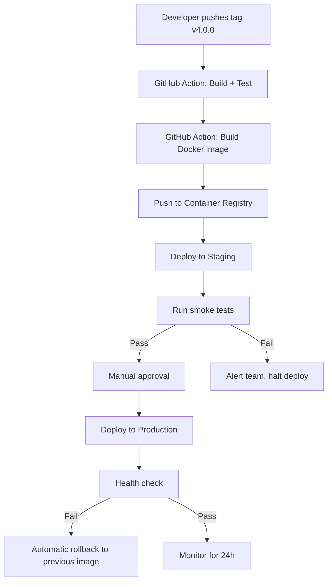

### 17.4 Rollback Strategy

| Scenario | Action | Time to Recover |
|----------|--------|----------------|
| Deployment failure | Automatic rollback to previous Docker image | <5 min |
| Model corruption | Reload MLflow artifact from previous version | <10 min |
| Database corruption | Restore from nightly backup | <30 min |
| LLM failure | Fallback to conservative mode (no LLM calls, rule-only verification) | <1 min |

### 17.5 Scaling (Future)

| Strategy | When | Implementation |
|----------|------|----------------|
| Horizontal | >10 concurrent users | Kubernetes with GPU node pool |
| Vertical | Model size increases | Upgrade to A100 80GB |
| Caching | Repeated similar cases | Redis cache for RAG embeddings |
| CDN | Static demo assets | CloudFront / Cloudflare |

---

## 18. MONITORING & OBSERVABILITY

### 18.1 Three Pillars

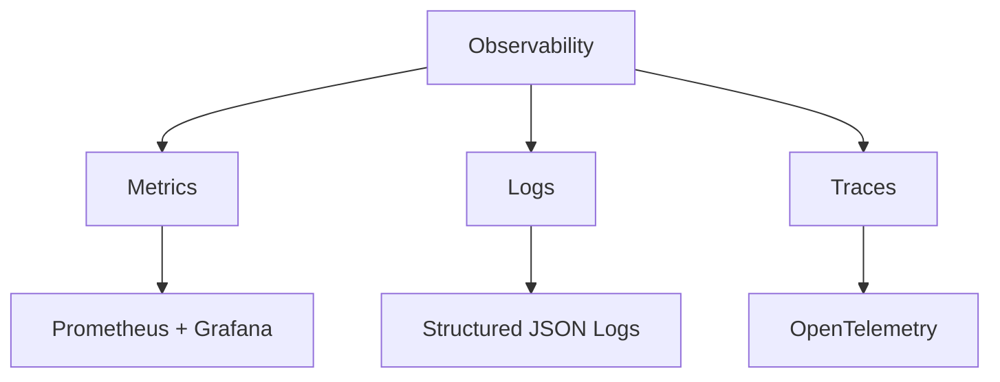

### 18.2 Metrics

| Metric | Type | Source | Alert Threshold |
|--------|------|--------|-----------------|
| Request latency | Histogram | FastAPI middleware | p95 > 30s |
| Error rate | Counter | Exception handler | > 5% in 5 min |
| GPU utilization | Gauge | `nvidia-smi` | > 95% for 10 min |
| GPU memory | Gauge | `nvidia-smi` | > 90% for 5 min |
| Inference time | Histogram | Orchestrator | p95 > 30s |
| Database query time | Histogram | SQLAlchemy events | p95 > 500ms |
| LLM call latency | Histogram | LLM client | p95 > 30s |
| LLM timeout rate | Counter | LLM client | > 10% in 1 hour |
| Case throughput | Counter | API | N/A (dashboard) |
| Abstention rate | Gauge | Consensus | Sudden spike > 50% |
| Escalation rate | Gauge | Consensus | Sudden spike > 20% |

### 18.3 Logs

**Structure (JSON):**
```json
{
  "timestamp": "2026-08-25T22:17:00+05:30",
  "level": "INFO",
  "logger": "src.agents.orchestrator",
  "event": "case_processed",
  "case_id": "uuid",
  "patient_id": "uuid",
  "consensus_level": 1,
  "diagnosis": "melanoma",
  "confidence": 0.87,
  "fusion_iterations": 2,
  "evidence_quality": {"clinical": 0.85, "dermoscopy": 0.78, "text": 0.65, "metadata": 0.90},
  "processing_time_ms": 12450,
  "model_version": "git:abc1234",
  "gpu_memory_mb": 18432
}
```

**Log Levels:**
- `DEBUG`: Detailed agent internals (disabled in production)
- `INFO`: Case processing events, state transitions
- `WARNING`: Missing modality, low quality, LLM retry
- `ERROR`: Agent failure, timeout, exception
- `CRITICAL`: OOD detection, critical conflict, security event

### 18.4 Traces

**OpenTelemetry spans:**
```
case_processing (root)
├── vision_analysis [12s]
│   ├── dermlip_panderm [4s]
│   ├── panderm [3s]
│   ├── swin_tiny [3s]
│   └── resnet152 [2s]
├── scribe_extraction [2s]
├── devil's_advocate [1s]
├── fusion [0.5s]
│   ├── iteration_0 [0.15s]
│   ├── iteration_1 [0.15s]
│   └── iteration_2 [0.15s]
├── consensus [0.1s]
├── verification [3s]
│   ├── stage_1 [0.1s]
│   └── stage_2 [2.9s]
└── report_generation [2s]
```

### 18.5 Dashboards

**Grafana Dashboards:**

1. **System Health**
   - GPU utilization & memory
   - Request rate & latency
   - Error rate

2. **Model Performance**
   - Accuracy over time
   - ECE trend
   - Abstention rate by condition

3. **Evidence Quality**
   - Average Q, R, C per modality
   - Conflict detection rate
   - OOD detection rate

4. **Business Metrics**
   - Cases processed per hour
   - Escalation rate
   - Average time to resolution

### 18.6 Alerts

| Condition | Severity | Channel | Action |
|-----------|----------|---------|--------|
| Error rate > 5% | P1 | Slack + Email | Page on-call |
| GPU memory > 95% | P1 | Slack | Kill stale processes |
| LLM timeout rate > 10% | P2 | Slack | Switch to fallback mode |
| Abstention rate spike | P2 | Slack | Investigate data drift |
| Disk space > 90% | P3 | Email | Cleanup old experiments |

---

## 19. FAILURE & RECOVERY

### 19.1 Failure Matrix

| Failure | Impact | Detection | Immediate Action | Recovery | Prevention |
|---------|--------|-----------|------------------|----------|------------|
| **Database unavailable** | Cannot save cases / retrieve history | Health check fails | Queue cases in memory, return 503 | Restart DB container, restore from backup | Connection pooling, automatic restart |
| **Backend API down** | Complete service outage | Health check fails | Return 503, show maintenance page | Restart container, check logs | Docker restart policy, load balancer |
| **Frontend unavailable** | Users cannot interact | Health check fails | Show static maintenance page | Restart Streamlit | Docker restart policy |
| **Vision model failure** | Reduced accuracy, missing predictions | Exception in model.forward() | Continue with remaining 3 models, log error | Reload model weights, restart Ollama | Model weight checksums, health checks |
| **LLM timeout** | No report generation, no verification | Timer exceeds 30s | Return fallback message, rule-only verification | Retry with temperature=0.1, then fallback | Kill switch, max tokens, timeout config |
| **External API failure** | Cannot retrieve guidelines | HTTP error from RAG | Skip guideline retrieval, continue with similar cases | Retry with backoff | Circuit breaker pattern |
| **Network failure** | Distributed components cannot communicate | Connection timeout | Queue tasks locally, retry | Restore network | Redundant networking |
| **Queue failure** | Background jobs stall | Queue depth > threshold | Process synchronously, alert team | Restart Redis/RabbitMQ | Queue persistence |
| **Worker failure** | DERMA-STRESS jobs fail | Worker process died | Re-queue failed jobs | Restart worker | Supervisor/systemd |
| **Authentication failure** | Clinicians locked out | Login error rate spike | Enable emergency bypass key (senior only) | Reset API keys, audit logs | Key rotation, MFA |
| **Deployment failure** | New version broken | Smoke test fails | Automatic rollback to previous image | Fix bug, re-deploy | Staging validation, canary deploy |
| **High traffic** | Latency spikes, GPU OOM | Request queue depth | Enable rate limiting, scale horizontally if possible | Add GPU nodes | Auto-scaling, caching |
| **Data corruption** | Incorrect predictions | Hash mismatch on load | Halt processing, quarantine data | Restore from clean backup | Checksums, immutable storage |
| **Storage failure** | Cannot save images/models | Disk I/O errors | Switch to secondary storage | Replace disk, restore from backup | RAID, cloud backup |

### 19.2 Recovery Playbooks

**Playbook: Vision Model Failure**
```bash
# 1. Identify failed model
docker logs derma-guard-api | grep "ModelLoadError"

# 2. Verify model weights
sha256sum models/dermlip_panderm/pytorch_model.bin

# 3. Reload from MLflow
mlflow artifacts download -r <run_id> -d models/

# 4. Restart service
docker-compose restart api

# 5. Verify health
curl http://localhost:8000/health
```

**Playbook: LLM Timeout Cascade**
```bash
# 1. Check Ollama status
docker logs derma-guard-ollama | tail -n 50

# 2. If OOM, restart
docker-compose restart ollama

# 3. Enable fallback mode (no LLM verification)
curl -X POST http://localhost:8000/admin/fallback-mode -H "Authorization: Bearer $ADMIN_KEY"

# 4. Monitor error rate
watch -n 5 'curl -s http://localhost:8000/metrics | grep error_rate'
```

---

## 20. SCALABILITY

### 20.1 Current Scale (Research Prototype)

| Resource | Capacity | Bottleneck |
|----------|----------|------------|
| Concurrent cases | 1 (single GPU) | GPU memory for 4 vision models |
| Cases per hour | ~120 | Inference time (30s/case) |
| Database | 10k cases | SQLite file size |
| Storage | 100GB | Raw image files |

### 20.2 Scaling Roadmap

| Phase | Trigger | Action | Implementation |
|-------|---------|--------|----------------|
| **Now** | Single user demo | Optimize batching, use mixed precision | `torch.cuda.amp`, batch_size=32 |
| **Phase 1** | >5 concurrent users | Model caching, request queuing | Redis queue, async FastAPI |
| **Phase 2** | >20 concurrent users | Model parallelism across GPUs | 2x GPU: models 1-2 on GPU 0, 3-4 on GPU 1 |
| **Phase 3** | >100 concurrent users | Horizontal scaling with load balancer | Kubernetes, GPU node pool |
| **Phase 4** | >1000 concurrent users | Separate inference microservices | Each agent = container, gRPC communication |

### 20.3 Caching Strategy

| Cache | Key | TTL | Storage |
|-------|-----|-----|---------|
| Model predictions | `pred:{model}:{image_hash}` | 1 hour | Redis |
| RAG embeddings | `emb:{case_id}` | 24 hours | FAISS (in-memory) |
| LLM responses | `llm:{prompt_hash}` | 1 hour | Redis |
| Similar cases | `rag:{embedding_hash}` | 1 hour | FAISS |

### 20.4 Database Scaling

| Stage | Strategy | When |
|-------|----------|------|
| Now | SQLite, single file | <10k cases |
| Phase 1 | Postgres, single instance | >10k cases |
| Phase 2 | Postgres + read replica | >100k cases |
| Phase 3 | Sharding by patient_id | >1M cases |

---

## 21. PROJECT EXECUTION PLAN

### 21.1 Gantt Chart

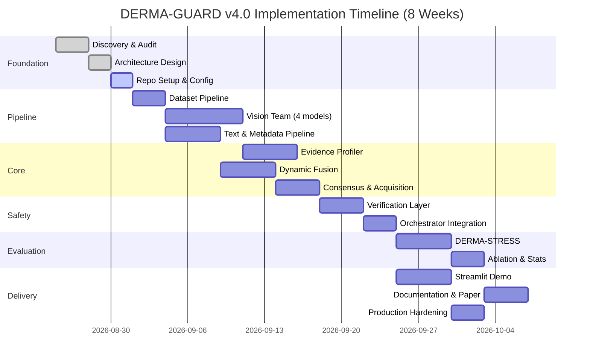

### 21.2 Phase Details

#### Phase 1 — Discovery (Days 1–3)
- **Objective:** Validate all assumptions
- **Tasks:** Dataset audit, model availability check, GPU benchmark
- **Deliverables:** Audit report, model load confirmation
- **Risks:** Model weights unavailable → Mitigation: use backup models

#### Phase 2 — Foundation (Days 4–7)
- **Objective:** Build infrastructure
- **Tasks:** Repo, Hydra, W&B, tests
- **Deliverables:** Running data pipeline, first W&B run
- **Risks:** Hydra learning curve → Mitigation: pair programming

#### Phase 3 — Vision Pipeline (Days 8–14)
- **Objective:** 4-model ensemble running
- **Tasks:** Load models, fine-tune Swin/ResNet, parallel inference
- **Deliverables:** `VisionSpecialistTeam` class
- **Critical Path:** Yes

#### Phase 4 — Text & Metadata (Days 8–12)
- **Objective:** Text and metadata pipelines
- **Tasks:** ClinicalBERT, PTIS, synthetic text, metadata MLP
- **Deliverables:** `ScribeAgent` class
- **Parallel with:** Phase 3

#### Phase 5 — Evidence Profiler (Days 15–19)
- **Objective:** Safety layer
- **Tasks:** OOD, reliability, consistency, missingness
- **Deliverables:** `DevilsAdvocateAgent`
- **Critical Path:** Yes

#### Phase 6 — Dynamic Fusion (Days 20–24)
- **Objective:** Core scientific contribution
- **Tasks:** Iterative EM, diagnosis-adaptive weights, focal loss
- **Deliverables:** `DiagnosisAdaptiveFusion`
- **Critical Path:** Yes

#### Phase 7 — Consensus & Acquisition (Days 25–28)
- **Objective:** Decision layer
- **Tasks:** 4-level hierarchy, arbitration, acquisition policy
- **Deliverables:** Consensus mechanism

#### Phase 8 — Verification & Orchestrator (Days 29–32)
- **Objective:** Hallucination prevention
- **Tasks:** Two-stage verification, LLM tool-calling
- **Deliverables:** `OrchestratorAgent` + `VerificationLayer`

#### Phase 9 — DERMA-STRESS (Days 33–37)
- **Objective:** Prove robustness
- **Tasks:** 15 conditions, baseline ladder, metrics
- **Deliverables:** Benchmark results

#### Phase 10 — Ablation & Stats (Days 38–40)
- **Objective:** Isolate contributions
- **Tasks:** Factorial ablation, bootstrap CIs, 3 seeds
- **Deliverables:** Statistical analysis

#### Phase 11 — Demo (Days 33–37)
- **Objective:** Demonstrate system
- **Tasks:** Patient App, Clinician Console, evidence viewer
- **Parallel with:** Phase 9

#### Phase 12 — Hardening (Days 41–43)
- **Objective:** Production readiness
- **Tasks:** Input sanitization, rate limiting, tests, docs
- **Deliverables:** Release v4.0.0

### 21.3 Critical Path

```
Discovery → Foundation → Vision Pipeline → Evidence Profiler → Dynamic Fusion → Consensus → Verification → DERMA-STRESS → Stats → Paper
```

**Parallel tracks:** Text pipeline (with Vision), Demo (with Stress), Hardening (with Stats)

---

## 22. TEAM RESPONSIBILITIES

### 22.1 RACI Matrix

| Task | Product Manager | ML Lead | CV Engineer | NLP Engineer | DevOps | QA |
|------|-----------------|---------|-------------|--------------|--------|-----|
| Requirements | **A** | C | C | C | I | C |
| Architecture | C | **A** | C | C | C | I |
| Dataset Audit | I | **A** | C | I | I | C |
| Vision Team | I | **A** | **R** | I | I | C |
| Text Pipeline | I | C | I | **A** | I | C |
| Evidence Profiler | I | **A** | C | I | I | C |
| Dynamic Fusion | I | **A** | C | C | I | C |
| Consensus | I | **A** | C | C | I | C |
| Verification | I | C | I | **A** | I | C |
| Orchestrator | I | C | I | **A** | I | C |
| DERMA-STRESS | I | **A** | C | C | I | C |
| Demo | C | C | I | I | I | **A** |
| CI/CD | I | I | I | I | **A** | C |
| Security | I | C | I | I | **A** | C |
| Documentation | **A** | C | C | C | I | C |

**Legend:** R = Responsible, A = Accountable, C = Consulted, I = Informed

### 22.2 Role Definitions

| Role | Responsibilities |
|------|-----------------|
| **Product Manager** | Requirements, stakeholder communication, paper narrative, "What Did Not Work" section |
| **ML Lead** | Architecture decisions, fusion algorithm, evaluation protocol, statistical validity |
| **CV Engineer** | Vision model loading, fine-tuning, Grad-CAM, image preprocessing |
| **NLP Engineer** | ClinicalBERT, LLM prompts, verification, report generation |
| **DevOps** | CI/CD, Docker, deployment, monitoring, security hardening |
| **QA** | Test strategy, manual testing, demo validation, edge case hunting |

---

## 23. PRODUCTION READINESS CHECKLIST

### 23.1 Pre-Deployment

- [ ] Requirements finalized and signed off
- [ ] Architecture approved by ML Lead + Product Manager
- [ ] Repository initialized with branch protection
- [ ] Development environment documented and reproducible
- [ ] Dataset audit clean (no hash collisions)
- [ ] Official splits frozen and committed
- [ ] All 4 vision models load successfully
- [ ] Qwen2.5-7B responds to test prompt
- [ ] Database schema finalized and migrated
- [ ] API contracts documented

### 23.1 Implementation

- [ ] Vision Specialist Team implemented and tested
- [ ] Scribe Agent implemented and tested
- [ ] Devil's Advocate implemented and tested
- [ ] Dynamic Fusion converges in ≤3 iterations
- [ ] 4-level consensus hierarchy implemented
- [ ] Acquisition policy selects correct modality in ≥70% of cases
- [ ] Two-stage verification catches ≥90% of unsupported claims
- [ ] Orchestrator uses tool-calling (not free-text reasoning)
- [ ] RAG index built over individual embeddings (not fused)
- [ ] Input sanitization: MIME, size, dimension checks
- [ ] Rate limiting: 5 pending cases per patient
- [ ] LLM kill switch: max tokens, timeout, retries, fallback

### 23.2 Quality

- [ ] Unit test coverage ≥70%
- [ ] Integration tests pass
- [ ] API tests pass
- [ ] DERMA-STRESS subset passes on every PR
- [ ] Full DERMA-STRESS run completed
- [ ] Baseline ladder results documented
- [ ] Ablation study completed
- [ ] Bootstrap 95% CIs computed
- [ ] 3–5 random seeds run
- [ ] "What Did Not Work" section written

### 23.3 Security

- [ ] Input validation tested (malicious files, SQL injection)
- [ ] Rate limiting tested
- [ ] Dependency vulnerabilities scanned (no critical issues)
- [ ] Secrets stored in `.env` (not committed)
- [ ] API keys hashed in database
- [ ] CORS configured
- [ ] No PII in logs

### 23.4 Operations

- [ ] CI/CD pipeline green
- [ ] Docker image builds successfully
- [ ] Health check endpoint responds
- [ ] Monitoring dashboards configured
- [ ] Alerts configured (Slack + Email)
- [ ] Log retention policy defined
- [ ] Backup strategy documented
- [ ] Rollback procedure tested
- [ ] Runbook for common failures

### 23.5 Documentation

- [ ] README with setup instructions
- [ ] API reference (auto-generated from FastAPI)
- [ ] Architecture decision records (ADRs) for major choices
- [ ] Dataset licenses committed
- [ ] Reproducibility statement committed
- [ ] Limitations document committed
- [ ] Demo video recorded
- [ ] Paper draft complete

---

## 24. COMPLETE "WHY / WHAT / HOW / WHEN"

### 24.1 WHY

> **Why are we building this?**

Skin cancer is deadly but treatable when caught early. Current AI dermatology systems are "black boxes" that force diagnoses even when evidence is blurry, conflicting, or insufficient. This is a patient-safety risk. We need a system that reasons like a clinical panel: multiple specialists evaluate evidence, a quality checker flags problems, and the team decides whether to diagnose, ask for more information, or escalate to a human expert.

### 24.2 WHAT

> **What exactly are we building?**

DERMA-GUARD v4.0: A multi-agent dermatological diagnosis system with:

1. **4 vision models** analyzing images in parallel (DermLIP-PanDerm, PanDerm, Swin-Tiny, ResNet152)
2. **A Scribe** extracting structured information from patient text
3. **A Devil's Advocate** checking evidence quality, reliability, and consistency
4. **Iterative diagnosis-adaptive fusion** that refines weights based on suspected diagnosis
5. **4-level consensus hierarchy** (Strong → Moderate → Uncertain → Critical Conflict)
6. **Simulated evidence acquisition** when consensus is uncertain
7. **Two-stage verification** to prevent hallucination
8. **DERMA-STRESS benchmark** with 15 corruption conditions
9. **Streamlit demo** for patients and clinicians

### 24.3 HOW

> **How does the entire system work technically?**

1. **Input:** Patient uploads images, text, and metadata
2. **Sanitization:** File type, size, and dimension checks
3. **Parallel Analysis:** 4 vision models + ClinicalBERT scribe run simultaneously
4. **Evidence Profiling:** Devil's Advocate computes Q, R, C, M + OOD score
5. **Stage 1 Verification:** If OOD or critical conflict → block or escalate immediately
6. **Dynamic Fusion:** Iterative EM-style refinement (max 3 iterations) with diagnosis-adaptive weights
7. **Consensus:** 4-level hierarchy decides: diagnose, arbitrate, acquire, or escalate
8. **Stage 2 Verification:** LLM checks report against evidence JSON
9. **Output:** Diagnosis + confidence + evidence trace + acquisition recommendation (if needed)

### 24.4 WHEN

> **When should each component be built?**

| Week | Focus | Key Deliverable |
|------|-------|-----------------|
| 1 | Foundation | Clean data pipeline, all models loading |
| 2 | Vision + Text | `VisionSpecialistTeam`, `ScribeAgent` |
| 3 | Evidence + Fusion | `DevilsAdvocateAgent`, `DiagnosisAdaptiveFusion` |
| 4 | Consensus + Verification | 4-level hierarchy, two-stage safety |
| 5 | Orchestrator + Demo | Full pipeline, Streamlit apps |
| 6 | DERMA-STRESS | Benchmark results |
| 7 | Ablation + Stats | Statistical validation |
| 8 | Hardening + Paper | Release v4.0, submit paper |

### 24.5 DONE

> **How do we know the project is actually complete?**

- [ ] All P0 functional requirements implemented
- [ ] Test coverage ≥70%, all CI checks green
- [ ] DERMA-STRESS results meet targets (≥75% stress accuracy, ≤0.10 ECE)
- [ ] Demo runs end-to-end without manual intervention
- [ ] Paper draft complete with "What Did Not Work" section
- [ ] Reproducibility package committed (seeds, configs, splits)
- [ ] Production readiness checklist 100% complete

### 24.6 OPERATE

> **What happens after production?**

- **Monitoring:** Watch error rates, latency, abstention rates via Grafana
- **Maintenance:** Weekly dependency scans, monthly model drift checks
- **Support:** Clinician escalation queue monitored daily
- **Logging:** Evidence traces retained for audit, research analysis quarterly

### 24.7 IMPROVE

> **How do we continue improving the system?**

| Quarter | Improvement | Expected Impact |
|---------|-------------|-----------------|
| Q1 | Replace lookup-table acquisition with gradient-boosted policy | +5% recovery rate |
| Q1 | Add DermatoLlama (11B VLM) as 5th vision specialist | +2% accuracy |
| Q2 | Real patient text (not synthetic) for PAD-UFES-20 | Better generalization |
| Q2 | Prospective validation with dermatologist panel | Clinical credibility |
| Q3 | Multi-language patient text support | Broader accessibility |
| Q3 | Longitudinal tracking (real follow-up data) | Temporal reasoning |
| Q4 | FDA pre-submission preparation | Regulatory pathway |

---

## 25. FIRST 10 ACTIONS

The exact first 10 things the team should do after reading this document:

1. **Clone the repository** and set up branch protection rules on `main` (require PR + 1 review + CI pass)

2. **Run the dataset audit** — execute `scripts/dataset_audit.py` on Derm7pt and PAD-UFES-20, fix any hash collisions, and commit the audit report to `docs/`

3. **Verify model availability** — attempt to load DermLIP-PanDerm, PanDerm, ClinicalBERT, and Qwen2.5-7B; document any failures and switch to backups immediately

4. **Create frozen splits** — run `scripts/make_splits.py` with seed=42, commit JSON files to `data/splits/`, and add a test that fails if splits are regenerated

5. **Set up Hydra configuration** — create `configs/base.yaml` with all hyperparameters from this document, verify CLI overrides work (`python train.py data.batch_size=16`)

6. **Initialize W&B project** — create a W&B project named `derma-guard-v4`, log a dummy run to verify API key and connectivity

7. **Implement the first unit test** — write `tests/test_data_pipeline.py` that verifies split reproducibility and class distribution; this becomes the CI baseline

8. **Load all 4 vision models** — write a script that loads DermLIP-PanDerm, PanDerm, Swin-Tiny, and ResNet152 in a single process; verify GPU memory usage is <20GB

9. **Write the Orchestrator prompt template** — draft the structured system prompt for Qwen2.5-7B with tool-calling definitions; test it with 5 sample cases

10. **Schedule the first team standup** — review this document, assign Phase 1 tasks, and set the deadline for Week 1 deliverables (dataset audit + model availability confirmation)

---

*End of DERMA-GUARD v4.0 Complete Project Documentation.*

**Part 1 + Part 2 = Full Document (Sections 1–25)**